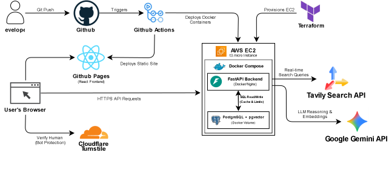

juansource (short for Juan’s Source of Truth) is a fact-checking web application designed to help Filipinos identify misinformation and fake news online. Built by students under the name Team AltTab, the project aims to make truth accessible to every Juan — simple, fast, and grounded in verified sources. 
> *In a sea of misinformation, juansource stands as a small voice that answers with truth.*

This project uses **FastAPI** for the backend and **React (Vite + TailwindCSS)** for the frontend.  
It integrates **LangChain**, **Google Generative AI**, and **Tavily Search API** for real-time fact-checking.

---

## 🏗️ Cloud Architecture

Originally built on Oracle Cloud, the application infrastructure has been fully migrated to **AWS EC2** and provisioned using **Terraform** (Infrastructure as Code).

<div align="center">
  
</div>

<details>
<summary>

<b>View Text-Based Data Flow</b>

```text
[ User / Browser ]
       | (Accesses Web App & completes Turnstile challenge)
       v
[ GitHub Pages (React Frontend) ] 
       | (HTTPS API Requests: /api/fact-check)
       v
[ AWS EC2 Instance (Ubuntu t3.micro provisioned via Terraform) ]
       |
       +--> [ Nginx (Reverse Proxy) ]
              | (Proxies /api to Backend)
              v
       [ Docker: FastAPI (Backend) ] <----------------+
              |                                       | (External API Integrations)
              +--(1. Verifies Token)------------> [ Cloudflare Turnstile ]
              |                                       |
              +--(2. Retrieves Evidence)--------> [ Tavily Search API ]
              |                                       |
              +--(3. Reasons & Embeds)----------> [ Google Gemini API ]
              |
              v (Reads/Writes)
       [ Docker: PostgreSQL w/ pgvector ]
         (Semantic Cache & Prompt Rate Limiting)
```
</summary>
</details>

🛠️ Infrastructure Stack
* Compute (Backend): AWS EC2 (Ubuntu t3.micro) provisioned via Terraform.

* Hosting (Frontend): GitHub Pages serving a compiled React/Vite SPA.

* Database: PostgreSQL with pgvector running inside Docker.

* Containerization: Docker & Docker Compose handling the Nginx reverse proxy, FastAPI, and Database.

* CI/CD: GitHub Actions.

## 🚀 Production Deployment
Use split deployment in production:

* Frontend: GitHub Pages

* Backend API + database: production server via Docker Compose on AWS EC2

1. Provision Infrastructure
Use the provided main.tf to provision the AWS EC2 instance and security groups.

```bash
terraform init
terraform apply
```

2. Configure Backend Secrets
Configure backend env in GitHub secret JUANSOURCE_BACKEND_ENV.

* Include your GitHub Pages origin in CORS_ALLOW_ORIGINS

* Keep ANON_COOKIE_SECURE=true and ANON_COOKIE_SAMESITE=none in production so prompt-guard cookies work cross-origin from GitHub Pages.

3. Start Production Services on EC2

```bash
docker compose -f docker-compose.prod.yml up -d
```

Open production endpoints:

* API reverse proxy (Nginx): http://localhost:3000/api
* Backend container (FastAPI): http://localhost:8001/docs
* Frontend app: GitHub Pages URL

## 💻 Local Development Setup

To run this project locally for development or testing:

1. Create or update backend/.env with your API keys.

```bash
GOOGLE_API_KEY=your_google_api_key_here
TAVILY_API_KEY=your_tavily_api_key_here
GEMINI_MODEL=gemini-2.5-flash
TURNSTILE_SECRET_KEY=your_turnstile_secret_key_here
ANON_COOKIE_SECRET=your_random_cookie_signing_secret
```
For frontend Turnstile widget, also set this environment variable before building frontend:

```bash
VITE_TURNSTILE_SITE_KEY=your_turnstile_site_key_here
```
2. Start all services (local/dev).

```bash
docker compose up --build
```
3. Open the apps (local/dev).
* Frontend: http://localhost:5173
* Backend: http://localhost:8001/docs
* PostgreSQL: localhost:5432

Semantic Cache (Gemini endpoint)
The /fact-check endpoint uses PostgreSQL + pgvector semantic caching.

* Top-1 vector match is checked before running full search + LLM.
* Cache match rule uses minimum similarity threshold.
* Cache rows expire using TTL.

Environment variables (configured in docker-compose.yml):

* SEMANTIC_CACHE_ENABLED (default true)
* SEMANTIC_CACHE_MIN_SIMILARITY (default 0.87)
* SEMANTIC_CACHE_TTL_SECONDS (default 86400)
* SEMANTIC_CACHE_EMBEDDING_MODEL (default models/text-embedding-001)

### Trusted Source Allowlist
Search is restricted to these sources:

* verafiles.org/articles
* gmanetwork.com/news
* news.abs-cbn.com
* newsinfo.inquirer.net
* philstar.com/headlines
* philstar.com/nation
* bworldonline.com

### Prompt Guard And Human Verification

* Anonymous users are identified with a signed HTTP-only cookie issued by backend.
* Prompt usage is limited to 3 requests per day per anonymous cookie ID.
* Daily reset follows Asia/Manila midnight.
* Cloudflare Turnstile verification is required before each prompt is processed.

## 📋 Features

* 💬 Fact-Checking Chatbot Interface — Conversational verification of claims and headlines.
* 🔍 Real-Time Data Retrieval — Integrates Tavily Search for fresh, source-backed results.
* 🧩 AI-Powered Reasoning — Uses Gemini (via LangChain) for classification and explanation.
* 🌐 Accessible Frontend — Built with React + Tailwind for clean, fast, and responsive use.
* 🛠️ Lightweight Backend — FastAPI handles API requests and RAG pipeline efficiently.

## 🚀 How It Works
1️⃣ User enters a claim or headline (e.g., “Apples are orange.”)
2️⃣ juansource fetches relevant snippets from Tavily Search.
3️⃣ The system analyzes the context using Gemini 2.5 Flash and LangChain.
4️⃣ Returns a classification (True / False / Uncertain) with reasoning and citations.

# 💜 Our Vision   
To make truth accessible, inclusive, and transparent for every Filipino. In the future, juansource aims to:

* Support Filipino and regional languages
* Monitor and combat misinformation trends in real-time
* Partner with media and educational institutions to promote digital literacy

### 💻 Team AltTab
*Built by students, for every Juan.* 💜 

- [@paulo10011](https://github.com/paulo10011) 
- [@CreampuffWasEatenBySora](https://github.com/CreampuffWasEatenBySora) 
- [@Neil-023](https://github.com/Neil-023)   
- [@A-tio](https://github.com/A-tio) 
- [@alhtb](https://github.com/alhtb) 
